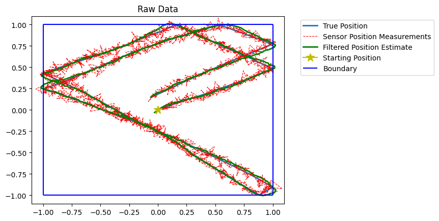

# Multivariate Kalman Filter

The multivariate Kalman filter is used to reduce noise in linear systems. It is designed to be used when modelling a stochostic process which has random noise in both the process and measurements. It requires knowing at least approximate equations for the state transition step.

[**Project Report**](YOUR_REPORT_URL) - will be uploaded shortly

## Preview

## Overview

This project was built to learn about a new method for filtering data and object oriented programming.

The main goal was to produce a generic class that could be applied to different systems and generate a statistically significant improvement.

## References

The equations I used in the filter can be found in:
- Kalman and Bayesian Filters in Python - Roger R Labbe Jr
- An Introduction to the Kalman Filter - Greg Welch and Gary Bishop

## Key Features

- **Feature 1:** Allows for smoother approximations of noisy systems.
- **Feature 2:** Reduces RMSE by approximately 50%.

## Tech Stack

- **Language:** Python
- **Libraries:** Numpy, Matplotlib

### Requirements

- Python 3 (Numpy, Matplotlib)

### Prerequisites

- Basic linear algebra.
- An understanding of multivariate Gaussian distributions and covariance matrices.

## How It Works

The filter compares error in its own estimate and a new measurement to produce a new estimate with less error than both the old estimate and the measurement.

1. **Input:** The filter class requires 3 integer inputs to initialise, dimension of the state vector, dimension of the measurement vector and dimension of the driving force. After initialising the filter needs the following constant matrices:
- state transition matrix (F) determining the equations governing the process,
- measurement function (H) converting the measurement to the same form as the state space,
- process covariance matrix (Q),
- measurement covariance matrix (R),
if there is a driving force:
- control transition matrix (B) which converts the driving force to the state space,
- driving force vector (u), can be a function.
It also needs the following initial conditions defined:
- inital state space,
- initial estimate covariance matrix (P), initially very large if the initial state space is uncertain.
4. **Process:** The filter works by compares covariance matrices to calculate the Kalmain gain matrix (K). The Kalman gain determines how much weight should be given to the measurement and the estimated position.
5. **Output:** The filter outputs a new state vector.

## Results and Key Learnings

- **Outcome:** The filter reduced RMSE by approximately 50% compared to sensor data.
- **Technical learning:** Explain a skill or concept you developed.
- **Challenge:** Describe a problem you encountered and how you addressed it.

## Future Improvements

- Implement an extended Kalman filter (EKF) to allow the modelling of non-linear systems.
- For the ball confined to a box demo, modify the filter by allowing it to know the bounds and add increased process variance near boundaries to force the filter to trust the measurements near bounces.

## Author

Euan Riach — [LinkedIn](https://www.linkedin.com/in/euan-riach) · [GitHub](https://github.com/EuanRiach)
